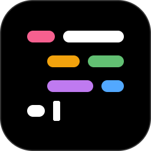
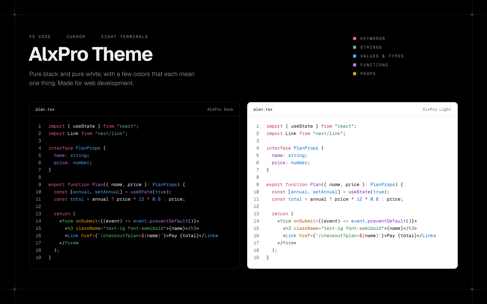
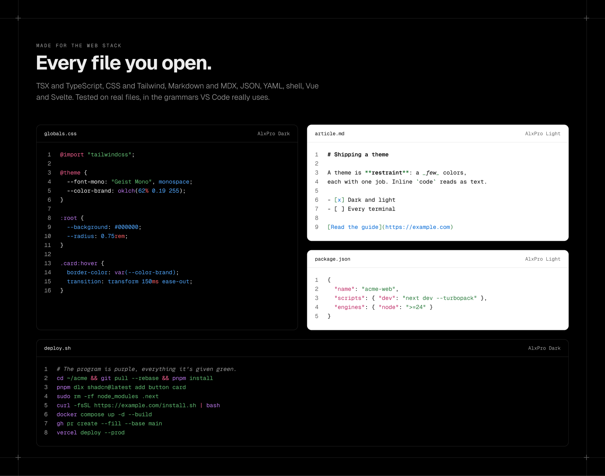
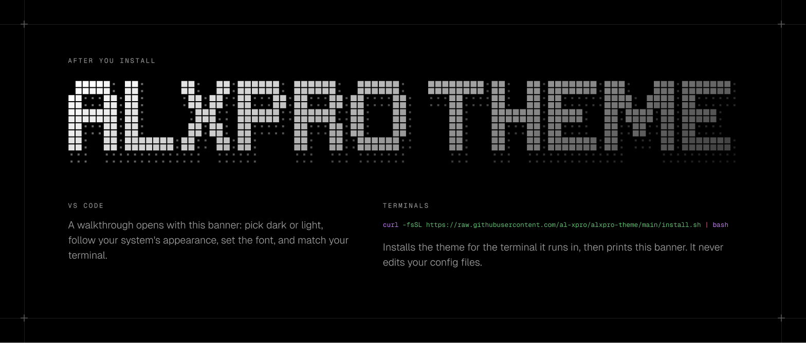
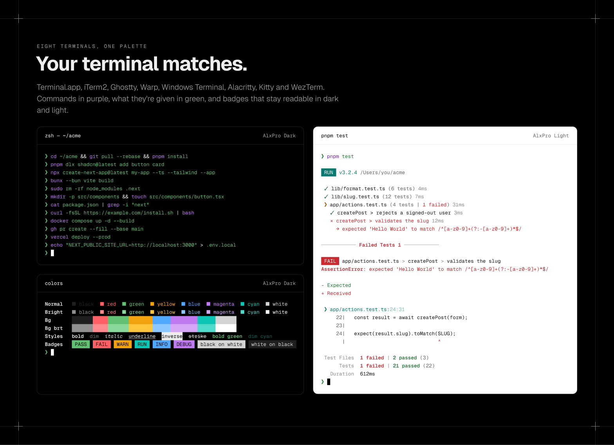
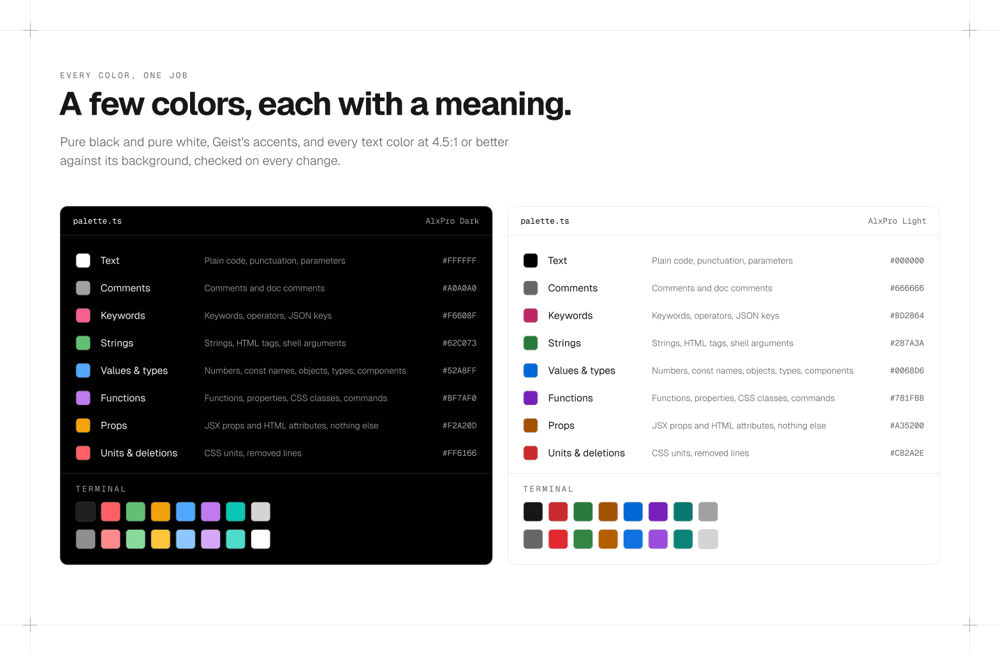

<p align="center">
  
</p>

<h1 align="center">AlxPro Theme</h1>

<p align="center">
  Black-and-white dark and light themes for web development, with matching colors for
  VS Code, Cursor, eight terminals and the web.
</p>

<p align="center">
  <a href="https://github.com/al-xpro/alxpro-theme/actions/workflows/ci.yml"></a>
  <a href="https://open-vsx.org/extension/alxpro/alxpro-theme"></a>
  <a href="https://www.npmjs.com/package/alxpro-theme"></a>
  <a href="LICENSE"></a>
</p>

<p align="center">
  <a href="https://marketplace.visualstudio.com/items?itemName=alxpro.alxpro-theme"><b>VS Code Marketplace</b></a> ·
  <a href="https://open-vsx.org/extension/alxpro/alxpro-theme"><b>Open VSX</b></a> (Cursor, Windsurf, VSCodium) ·
  <a href="https://www.npmjs.com/package/alxpro-theme"><b>npm</b></a> ·
  <a href="https://github.com/mbadolato/iTerm2-Color-Schemes"><b>iTerm2-Color-Schemes</b></a> ·
  <a href="https://github.com/al-xpro/alxpro-theme/releases/latest"><b>Releases</b></a>
</p>



- **Pure black and pure white backgrounds**, with white or black text, and a few accents
  that mean one thing each: pink keywords, green strings, blue values and types, purple
  functions and properties, and amber kept for props, where they're passed and where they're
  received.
- **Made for the web stack**: TSX, TypeScript, CSS and Tailwind, HTML, JSON, YAML,
  Markdown, MDX, shell, Vue and Svelte, tested on real files in [`samples/`](samples/).
- **Shell commands read at a glance**: the program is purple, everything it's given is
  green, and each `&&` or `|` starts over.
- **Readable everywhere**: every syntax and terminal text color is at least 4.5:1 (WCAG AA)
  against its background, checked in CI.
- **The same colors in your terminal**: Terminal.app, iTerm2, Ghostty, Warp, Windows
  Terminal, Alacritty, Kitty, WezTerm, and VS Code's own terminal.
- **The whole editor is themed**: tabs, sidebar, menus, widgets, diff, git and the status
  bar, so nothing falls back to VS Code's blue and purple.
- **Code blocks in the Markdown preview** use the palette too, while AlxPro is your theme.
  The preview colors code with highlight.js, which tells fewer things apart than the
  editor: a CSS unit takes its number's blue, a JSX component is green like an HTML tag,
  and in shell blocks only built-in commands like `cd` are colored.
- **Your site can match your editor**: the [npm package](#on-the-web) carries the same
  themes for Shiki, terminal colors for xterm.js, and every color as a CSS variable.



## Install

### VS Code

Search for **AlxPro Theme** in the Extensions view, or:

```bash
code --install-extension alxpro.alxpro-theme
```

A short walkthrough opens after installing: pick dark or light, follow your system, set the
font, and match your terminal. Reopen it any time with **Welcome: Open Walkthrough…** →
**AlxPro Theme**.



Or run **Preferences: Color Theme** and pick **AlxPro Dark** or **AlxPro Light**. To follow
the system's appearance:

```jsonc
// settings.json
"window.autoDetectColorScheme": true,
"workbench.preferredDarkColorTheme": "AlxPro Dark",
"workbench.preferredLightColorTheme": "AlxPro Light"
```

VS Code's **Agents** window only runs extensions it knows are safe there, and for now that
excludes AlxPro, because the extension also adds a walkthrough. To use the themes there too:

```jsonc
// settings.json
"extensions.supportAgentsWindow": { "alxpro.alxpro-theme": true }
```

### Cursor, Windsurf, VSCodium

These install from [Open VSX](https://open-vsx.org/extension/alxpro/alxpro-theme): search
for **AlxPro Theme** in the Extensions view. They color code the same way VS Code does, so
the themes look the same there.

Every release also attaches the `.vsix` on the
[Releases page](https://github.com/al-xpro/alxpro-theme/releases). Install it with
**Extensions: Install from VSIX…**.

### Terminals

Both themes are in [iTerm2-Color-Schemes](https://github.com/mbadolato/iTerm2-Color-Schemes),
a collection that many terminals' theme lists come from. Ghostty bundles it, so a future
Ghostty release will list **AlxPro Dark** and **AlxPro Light** with nothing to copy.

To install them now, run this in the terminal you want to theme. It works out which terminal it is, installs
both themes there, and tells you the one line to add to turn them on. It never edits your
config files.

```bash
curl -fsSL https://raw.githubusercontent.com/al-xpro/alxpro-theme/main/install.sh | bash
```

To name the terminal yourself, add it after `bash -s --`: `terminal-app`, `iterm2`,
`ghostty`, `warp`, `wezterm`, `kitty`, `alacritty` or `vscode`. Prefer to do it by hand?
Every theme is in [`themes/`](themes/), and also zipped on the
[Releases page](https://github.com/al-xpro/alxpro-theme/releases).

| Terminal | File | How |
| --- | --- | --- |
| Terminal.app | [`terminal-app/`](themes/terminal-app/) | Double-click the `.terminal` file, then **Settings → Profiles → Default**. |
| iTerm2 | [`iterm2/`](themes/iterm2/) | **Settings → Profiles → Colors → Color Presets → Import…**, then pick it from the same menu. |
| Ghostty | [`ghostty/`](themes/ghostty/) | Copy both files to `~/.config/ghostty/themes/`, then set `theme = light:AlxPro Light,dark:AlxPro Dark` in your Ghostty config. |
| Warp | [`warp/`](themes/warp/) | Copy the `.yaml` files to `~/.warp/themes/`, then **Settings → Appearance → Themes**. |
| Windows Terminal | [`windows-terminal/`](themes/windows-terminal/) | Add each JSON object to `"schemes"` in `settings.json`, then set a profile's `"colorScheme"` to `"AlxPro Dark"`. |
| Alacritty | [`alacritty/`](themes/alacritty/) | Copy the file next to your config and add `import = ["alxpro-dark.toml"]` under `[general]`. |
| Kitty | [`kitty/`](themes/kitty/) | Copy the file to `~/.config/kitty/` and add `include alxpro-dark.conf` to `kitty.conf`. |
| WezTerm | [`wezterm/`](themes/wezterm/) | Copy the file to `~/.config/wezterm/colors/` and set `config.color_scheme = "AlxPro Dark"`. |

VS Code's integrated terminal uses the same colors without any setup.

#### Command colors in your shell

A terminal theme sets the 16 colors. What your shell does with them while you type is your
shell's choice. To get the purple command and green arguments in the terminal too:

**zsh**, with [zsh-syntax-highlighting](https://github.com/zsh-users/zsh-syntax-highlighting),
after it's loaded in `~/.zshrc`:

```zsh
for style in command builtin alias function precommand hashed-command arg0; do
  ZSH_HIGHLIGHT_STYLES[$style]='fg=magenta'
done
for style in default path globbing single-hyphen-option double-hyphen-option \
  single-quoted-argument double-quoted-argument dollar-quoted-argument; do
  ZSH_HIGHLIGHT_STYLES[$style]='fg=green'
done
```

**fish**:

```fish
set -U fish_color_command magenta
set -U fish_color_param green
set -U fish_color_option green
set -U fish_color_quote green
```



## Recommended settings

The themes are drawn with [Geist Mono](https://vercel.com/font) in mind
(`brew install --cask font-geist-mono`, or download it). A theme can't set a font, so:

```jsonc
// settings.json
"editor.fontFamily": "'Geist Mono', ui-monospace, monospace",
"editor.fontSize": 14,
"editor.lineHeight": 1.7,
"terminal.integrated.fontFamily": "'Geist Mono'"
```

To see the theme as it's designed, check your extensions. Some change how code is tagged,
and so its colors, in every theme:

- **Tailwind CSS IntelliSense**: install it if you write Tailwind CSS v4 (in Cursor and
  VSCodium too, from Open VSX). Without it, `@theme`, `@layer` and `@custom-variant` aren't
  understood, and the CSS after them loses its colors.
- **PostCSS Language Support**: don't use it. It replaces VS Code's CSS grammar, in `.scss`
  files too, with one that reads property names (`display`, `gap`) and the variables in
  `@theme` as HTML tags, so they're green instead of blue.
- **YAML** by Red Hat, and **GitHub Actions** in workflow files: their grammars read a key
  that is also a YAML 1.1 boolean, like a workflow's `on:`, as a boolean, so it's blue
  instead of pink like every other key. Nothing else changes, so keep them if you use them.

Semantic highlighting is off on purpose, so VS Code colors code exactly as
[Shiki](https://shiki.style) does on the web. Bracket pair colorization is themed to match
the punctuation, so brackets stay plain unless one is unmatched.

## The palette

| Role | Dark | Light |
| --- | --- | --- |
| Background | `#000000` | `#FFFFFF` |
| Text, punctuation, parameters | `#FFFFFF` | `#000000` |
| Comments | `#A0A0A0` | `#666666` |
| Keywords, operators, JSON keys, `${…}`, CSS units | `#F6608F` | `#BD2864` |
| Strings, HTML tags, shell arguments | `#62C073` | `#287A3A` |
| Numbers, `const` names, objects (`event` in `event.preventDefault()`), types, interfaces, classes, components, CSS properties and `:root` variables, links | `#52A8FF` | `#0068D6` |
| Functions, methods, properties, CSS classes and pseudo-classes, shell commands | `#BF7AF0` | `#781FBB` |
| Props: attributes in markup (`className=`, `href=`), and the props a component receives (`{ title, href }`) | `#F2A20D` | `#A35200` |
| Deletions | `#FF6166` | `#CB2A2E` |



Every value lives in [`src/palette.ts`](src/palette.ts).

## On the web

Your site, blog and docs can match your editor with the
[`alxpro-theme`](https://www.npmjs.com/package/alxpro-theme) npm package
([its README](npm/README.md)): Shiki themes (for Shiki, rehype-pretty-code,
Expressive Code, Fumadocs and Nextra), terminal colors for xterm.js, and every color as a CSS
custom property.

```bash
npm install alxpro-theme
```

```ts
import { createHighlighter } from "shiki";
import { alxproDark, alxproLight } from "alxpro-theme";

const highlighter = await createHighlighter({
  themes: [alxproDark, alxproLight],
  langs: ["tsx", "css", "bash"],
});
const html = highlighter.codeToHtml(code, {
  lang: "tsx",
  themes: { light: "alxpro-light", dark: "alxpro-dark" },
});
```

## How the themes are made

Built with TypeScript, run directly by Node.js, and no runtime dependencies. The checks use
[vscode-textmate](https://github.com/microsoft/vscode-textmate) to tokenize like VS Code,
[Shiki](https://shiki.style) for the npm package and the preview page, and
[Playwright](https://playwright.dev) for renders. GitHub Actions builds, checks and
publishes every release.

```text
src/palette.ts            every color, for both themes: syntax, terminal, editor UI
src/formats/vscode.ts     which scopes each syntax role colors, and the editor's UI colors
src/formats/terminals.ts  the 16 terminal colors in each terminal's format
src/formats/npm.ts        the npm package: Shiki themes, terminal colors, CSS variables, types
scripts/build.ts          writes themes/ and npm/ from the above
scripts/check.ts          contrast, badges, and (on macOS) Terminal.app read-back
themes/, npm/dist/        generated, committed, never edited by hand
samples/, preview/        test files and a page that renders them with the real themes
```

```bash
npm install
npm run build     # regenerate themes/ after editing src/
npm run check     # contrast and file checks
npm run preview   # http://localhost:4321/preview/: hover a token to see its scopes
npm run scopes -- samples/globals.css   # every token's color and scopes, as your VS Code colors them
npm run images    # quick before/after renders of the samples, into dist/renders/
npm run package   # build the .vsix into dist/
```

To try a change in VS Code, open the repository and press **F5**. That starts an Extension
Development Host with the themes installed. Open [`samples/`](samples/) there, and run
[`samples/terminal/show.sh`](samples/terminal/show.sh) in any terminal to see its colors.

Found a wrong color? [Open an issue](https://github.com/al-xpro/alxpro-theme/issues/new/choose).
Include the scope from **Developer: Inspect Editor Tokens and Scopes**.
To contribute a fix, see [`CONTRIBUTING.md`](CONTRIBUTING.md).

## How this was built

The palette was first built for the code blocks on my own site, then published as a
standalone theme in October 2026. It's developed in the open with an agentic workflow: I
write issues as specs, agents open the pull requests, and I review and merge every change.
The rules are in [`AGENTS.md`](AGENTS.md).

## Roadmap

See the [open issues](https://github.com/al-xpro/alxpro-theme/issues).

- [x] VS Code Marketplace, Open VSX and npm
- [x] [iTerm2-Color-Schemes](https://github.com/mbadolato/iTerm2-Color-Schemes), and through
  it Ghostty's built-in list
- [ ] [Warp's themes](https://github.com/warpdotdev/themes)
  ([pull request](https://github.com/warpdotdev/themes/pull/171))

## Credits

The colors are inspired by Vercel's [Geist](https://vercel.com/geist) design system. This
project is not affiliated with or endorsed by Vercel.

## License

[MIT](LICENSE) © 2026 Alex Prostamo
