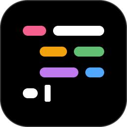
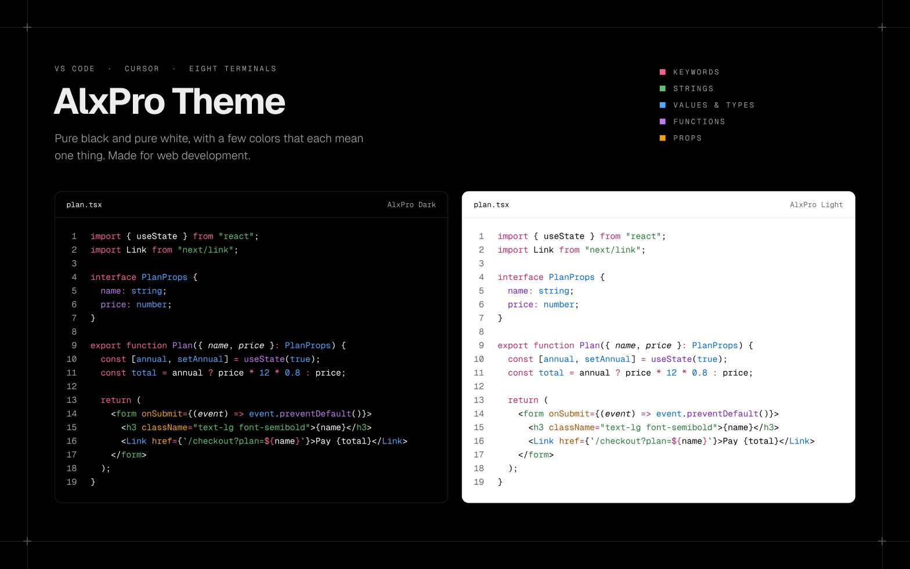
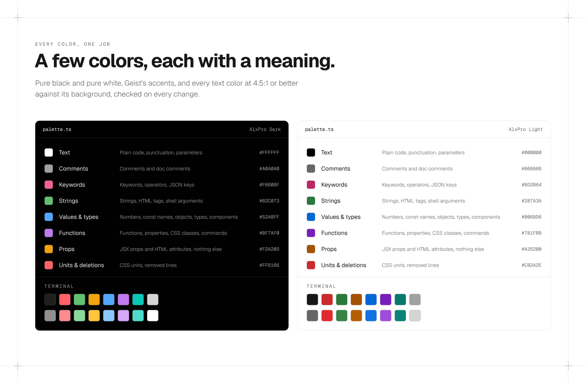

<p align="center">
  
</p>

<h1 align="center">alxpro-theme</h1>

<p align="center">
  AlxPro Dark and AlxPro Light for the web: Shiki themes, terminal colors and CSS variables,
  so your site, blog and docs match your editor.
</p>

<p align="center">
  <a href="https://www.npmjs.com/package/alxpro-theme"></a>
  <a href="https://www.npmjs.com/package/alxpro-theme"></a>
  <a href="https://github.com/al-xpro/alxpro-theme/actions/workflows/ci.yml"></a>
  <a href="https://github.com/al-xpro/alxpro-theme/blob/main/LICENSE"></a>
</p>

<p align="center">
  <a href="https://github.com/al-xpro/alxpro-theme"><b>GitHub</b></a> ·
  <a href="https://github.com/al-xpro/alxpro-theme/blob/main/CHANGELOG.md"><b>Changelog</b></a> ·
  <a href="https://marketplace.visualstudio.com/items?itemName=alxpro.alxpro-theme"><b>VS Code</b></a> ·
  <a href="https://open-vsx.org/extension/alxpro/alxpro-theme"><b>Open VSX</b></a> ·
  <a href="https://github.com/al-xpro/alxpro-theme#terminals"><b>Terminals</b></a>
</p>



- **Shiki themes**, for Shiki and everything built on it: rehype-pretty-code, Expressive
  Code and Starlight, Fumadocs, Nextra.
- **Terminal colors** as xterm.js reads them, plus the header, border, muted text and
  prompt of a terminal block you draw yourself.
- **Every color as a CSS custom property**, light on `:root` and dark under `.dark` or
  `[data-theme="dark"]`, ready for Tailwind's `@theme`.
- **Pure black and pure white**, with a few accents that mean one thing each: pink
  keywords, green strings, blue values and types, purple functions, amber props.
- **Readable**: every syntax and terminal text color is at least 4.5:1 (WCAG AA) against
  its background, checked on every change.
- **Small and typed**: ES modules, TypeScript types, no dependencies.

## Install

```bash
npm install alxpro-theme
```

| Import | What it is |
| --- | --- |
| `alxproDark`, `alxproLight`, `themes` | Shiki / TextMate themes, named `alxpro-dark` and `alxpro-light` |
| `terminal.dark`, `terminal.light` | Terminal colors as xterm.js's `ITheme`, plus a block's `header`, `border`, `muted` and `prompt` |
| `palette.dark`, `palette.light` | Every color: syntax roles, the 16 ANSI colors, editor UI |
| `alxpro-theme/dark.json`, `alxpro-theme/light.json` | The Shiki themes as JSON files |
| `alxpro-theme/css` | Every color as a CSS custom property |

## Shiki

```ts
import { codeToHtml } from "shiki";
import { alxproDark, alxproLight } from "alxpro-theme";

const html = await codeToHtml(code, {
  lang: "tsx",
  themes: { light: alxproLight, dark: alxproDark },
});
```

With a highlighter you create once, load both with `themes: [alxproDark, alxproLight]` and
pick them by name: `themes: { light: "alxpro-light", dark: "alxpro-dark" }`.

With two themes, Shiki writes the light color inline and the dark one as `--shiki-dark` on
each token. Switch to it with CSS, for example under a `.dark` class:

```css
.dark .shiki,
.dark .shiki span {
  color: var(--shiki-dark) !important;
  background-color: var(--shiki-dark-bg) !important;
}
```

## rehype-pretty-code

```ts
import rehypePrettyCode from "rehype-pretty-code";
import { alxproDark, alxproLight } from "alxpro-theme";

rehypePrettyCode({ theme: { dark: alxproDark, light: alxproLight } });
```

## Expressive Code

```ts
// astro.config.mjs
import { defineConfig } from "astro/config";
import expressiveCode from "astro-expressive-code";
import { alxproDark, alxproLight } from "alxpro-theme";

export default defineConfig({
  integrations: [expressiveCode({ themes: [alxproDark, alxproLight] })],
});
```

In Starlight, the same `themes` go in its `expressiveCode` option. Expressive Code takes the
colors of its editor and terminal frames from the themes too.

## Terminals

```ts
import { Terminal } from "@xterm/xterm";
import { terminal } from "alxpro-theme";

new Terminal({ theme: terminal.dark });
```

For a terminal block drawn in HTML, the same colors are CSS custom properties, chrome
included:

```css
@import "alxpro-theme/css";

.terminal {
  border: 1px solid var(--alxpro-terminal-border);
  background: var(--alxpro-terminal-background);
  color: var(--alxpro-terminal-foreground);
}
.terminal header {
  border-bottom: 1px solid var(--alxpro-terminal-border);
  background: var(--alxpro-terminal-header);
  color: var(--alxpro-terminal-muted);
}
.terminal .prompt {
  color: var(--alxpro-terminal-prompt);
}
.terminal .error {
  color: var(--alxpro-terminal-red);
}
```

## CSS variables

`alxpro-theme/css` sets every color on `:root` for AlxPro Light, and again under `.dark` or
`[data-theme="dark"]` for AlxPro Dark, the way Tailwind and next-themes switch. Every key has
one, in kebab case:

- `--alxpro-syntax-*`: the syntax roles, such as `keyword`, `string` or `style-property`.
- `--alxpro-terminal-*`: the terminal colors, such as `background`, `bright-red` or
  `selection-background`, and a block's `header`, `border`, `muted` and `prompt`.
- `--alxpro-ui-*`: the editor's UI, such as `background`, `border` or `muted`.

### Tailwind CSS

```css
@import "tailwindcss";
@import "alxpro-theme/css";

@theme inline {
  --color-keyword: var(--alxpro-syntax-keyword);
  --color-string: var(--alxpro-syntax-string);
}
```

## The palette



| Role | CSS variable | In `palette.dark` and `palette.light` |
| --- | --- | --- |
| Text, punctuation, parameters | `--alxpro-syntax-foreground` | `syntax.foreground` |
| Comments | `--alxpro-syntax-comment` | `syntax.comment` |
| Keywords, operators, JSON keys, CSS units | `--alxpro-syntax-keyword` | `syntax.keyword` |
| Strings, HTML tags, shell arguments | `--alxpro-syntax-string` | `syntax.string` |
| Numbers, `const` names, types, components | `--alxpro-syntax-constant` | `syntax.constant` |
| Functions, properties, CSS classes, shell commands | `--alxpro-syntax-function` | `syntax.function` |
| Props: attributes in markup, and the props a component receives | `--alxpro-syntax-attribute` | `syntax.attribute` |
| Deletions | `--alxpro-syntax-deleted` | `syntax.deleted` |

Every role, with what it colors, is in
[`src/palette.ts`](https://github.com/al-xpro/alxpro-theme/blob/main/src/palette.ts).

## In your editor and terminal

This package is the web side of [AlxPro Theme](https://github.com/al-xpro/alxpro-theme). The
same themes install in
[VS Code](https://marketplace.visualstudio.com/items?itemName=alxpro.alxpro-theme), in
Cursor, Windsurf and VSCodium from
[Open VSX](https://open-vsx.org/extension/alxpro/alxpro-theme), and in
[eight terminals](https://github.com/al-xpro/alxpro-theme#terminals) with one command.

## Versions

The package has the same version as the VS Code extension and is generated from the same
palette, so a version number means the same colors everywhere. What changed in each one is
in the [changelog](https://github.com/al-xpro/alxpro-theme/blob/main/CHANGELOG.md).

Found a wrong color? [Open an issue](https://github.com/al-xpro/alxpro-theme/issues/new/choose).

## License

[MIT](https://github.com/al-xpro/alxpro-theme/blob/main/LICENSE) © 2026 Alex Prostamo.
Colors inspired by Vercel's Geist design system; not affiliated with or endorsed by Vercel.
